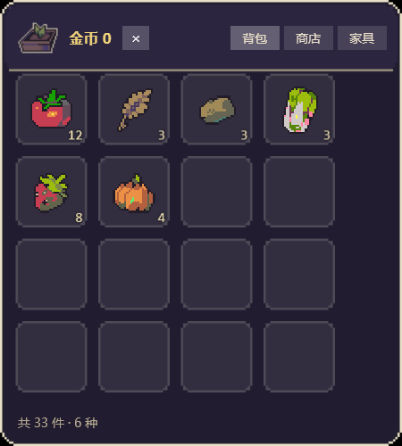

# 背包窗口（bag）

桌宠右键菜单里的「背包」打开的就是它。



## 长什么样

照游戏里的 UI 做法：**圆角面板 + 斜面边框 + 物品格栅**，标题栏带农场图标，格子里的数量压在右下角，
空槽也画出来（固定 16 格）。

## 美术怎么来的

游戏里的 UI 形状是「白色蒙版 + 运行时染色」，所以底板和格子也是用游戏自己的形状拼的：

| 素材 | 用途 |
|---|---|
| `assets\sprites\ui_background_default24_border.png` | 面板外框的圆角形状 |
| `assets\sprites\ui_background_item.png` | 物品格的形状 |
| `assets\sprites\ui_menuicon_farm.png` | 标题栏图标 |
| `assets\sprites\icon_item_*.png` | 格子里的物品图标 |

`bag\art\panel.png`（360×400）、`bag\art\slot.png`（64×64）已生成好；旧生成脚本已删除。
都是 2 倍最近邻放大，跟图层同一个像素刻度。

**想换风格**：直接替换 `bag\art\panel.png` / `slot.png`，
或者直接替换 `art\panel.png` 和 `art\slot.png` 这两张图，脚本一行都不用动。

## 行为

- 只读 `Pet\overlay\runtime\state.json`（farm World 每 5 秒写一次），每秒刷新
- 拖动面板移动，右上角 × 或 Esc 关闭
- 单实例：已经开着再点菜单不会再开一个

## 单独跑

```powershell
Set-ExecutionPolicy -Scope Process Bypass -Force
.\bag.ps1                 # × 或 Esc 关闭
.\bag.ps1 -Seconds 5      # 5 秒后自动关（自检用）
```

## 它怎么被打开

```
右键菜单「背包」 tile
   → pet-app.js  send({ t: 'control', action: 'bag' })
   → src/world.ts onControl('bag')  → spawn powershell bag.ps1
   → 本窗口
```

前两步是**本地补丁**，打在 Coopanion 自己的桌宠扩展包里：

| 文件 | 改了什么 |
|---|---|
| `node_modules\cortico-world-desktop-pet\web\ui.js` | `ICONS.bag` 图标 |
| `...\web\pet-app.js` | 菜单的 `ACTIONS` 表加一项 `bag` |
| `...\src\world.ts` | `onControl` 加 `action === 'bag'` → spawn 本脚本 |

**Coopanion 升级会覆盖这三个文件**，重跑 `..\scripts\repatch-pet-menu.ps1` 即可（幂等）；`-Restore` 可还原。
